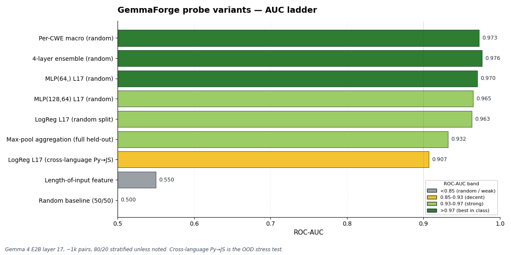

# GemmaForge — Two Gemmas, One Laptop: Local Repo-Wide Vulnerability Auditing

**Tracks:** Main Track · Impact: Safety & Trust · Special Tech: Ollama

**Repo:** https://github.com/peaktwilight/gemmaforge
**Live demo:** https://huggingface.co/spaces/peaktwilight/gemma4ge
**Video:** https://youtube.com/watch?v=TODO

## Team — security meets interpretability

- [**Doruk Tan Ozturk**](https://doruk.ch) ([@peaktwilight](https://github.com/peaktwilight)) — security researcher, ex-ETH Zürich. Disclosed [CVE-2026-33896](https://github.com/digitalbazaar/forge/security/advisories) in `node-forge`, plus a number of additional CVE-grade vulnerabilities across widely-deployed npm packages. Builder of [`pwnkit`](https://github.com/0sec-labs/pwnkit) (agentic AI pentest framework) and [**0sec.ai**](https://0sec.ai). Knows what a bug looks like in source — and built the Tier-2 agent runtime this submission depends on.
- **Mehmet Efe Akça** — MSc Data Science, ETH Zürich. Coursework in *Reliable and Trustworthy AI*, *Probabilistic AI*. TA for *Mathematics of Signals, Networks, and Learning*. Built the linear-probe path: dataset, activation capture, training, evaluation. Knows how to read what a neural network is thinking.

Doruk alone gives you a scanner; Efe alone gives you a probe. Together: **a probe that knows about danger, and an agent that can prove it.**

## The pitch in one paragraph

GemmaForge is a two-tier, fully-local vulnerability auditing pipeline built on the Gemma 4 family. **Tier 1 is an activation-probe scan** that sweeps a whole repo and emits a ranked JSONL of suspect spans with predicted CWE classes. The user picks one of two probe variants by hardware:

- **`weak-probe`** — Gemma 4 E2B (~2B), bounded line/token windows, high recall, laptop-class. The default and the one our metrics validate.
- **`strong-probe`** — a larger Gemma checkpoint as the probe backbone, with larger windows and more repo context. Better ranking and long-context understanding; needs workstation-class hardware. Same lead schema, same downstream contract.

**Tier 2 is the pwnkit verifier** — Gemma 4 8B driving a tool-using agent (`pwnkit review --seed-findings --runtime ollama`) that consumes the leads as its primary worklist, reads files, greps call sites, and streams tool-grounded audit verdicts back into the dashboard's Hunt lane. **Nothing leaves the laptop.** A solo maintainer with an old MacBook runs `weak-probe`; a developer with a 24GB-class GPU or a 32GB-class M-series Mac can run `strong-probe` and/or the full pipeline through the verifier. Same model family, same tokenizer, same Apache-2.0–licensed glue code.

## The problem

AI coding assistants now write a large and rising share of code that ships to production. A meaningful slice of it is vulnerable — every public benchmark of code-generation models shows steady-state emission of SQL injection, path traversal, command injection, weak crypto, and hardcoded credentials.

The industry answer is "scan afterwards" with Snyk, Semgrep, or CodeQL. Three failure modes:

1. **Too late.** By the time a SAST tool runs, the model has already shown the developer the insecure suggestion. Most developers paste first.
2. **Cloud-bound.** SAST requires shipping the code somewhere. Solo maintainers, air-gapped enterprises, regulated industries, and anyone in a country where a Snyk seat costs more than a month's rent are excluded.
3. **Static rules.** Scanners catch what they were told to catch. They never tell you that *the model itself* was uncertain about what it just wrote.

We asked a sharper question:

**What if the model could tell you which parts of your repo look like the code that gets CVEs filed against it — and then a bigger version of the same model could read the file and confirm?**

That product is GemmaForge.

## The technique

### Tier 1 — activation-probe scan (this repo)

A linear classifier on a Gemma 4 hidden state. Binary label: *"the code is the vulnerable side of a known patch pair."* The probe head is ~1,536 weights, well under 10 KB, sub-ms per token of overhead on the same MPS/CUDA device as Gemma. Inspired by [Obeso, Arditi et al. (2025)](https://arxiv.org/abs/2509.03531), which showed a linear probe on hidden states detects hallucinated entities at AUC > 0.9 — we adapt the same technique to vulnerability likelihood.

**Two probe variants, same scoring contract:**

- **`weak-probe` (shipped today, what the metrics below validate).** Backbone: `google/gemma-4-E2B-it`, layer 17. Bounded line/token windows over the repo; aggregated with `top-k mean` over per-position scores. Designed for high recall on laptop-class hardware.
- **`strong-probe` (shipped, Gemma 4 E4B, layer 10).** Same code path, larger backbone. Head-to-head on `data/pairs.jsonl` (group-split, n=1198, 95% bootstrap CI): strong wins **group_repo 0.969 vs 0.960** (+0.009), **CWE-78 0.998 vs 0.986** (+0.012), **lang=python 0.998 vs 0.991** (+0.007); loses CWE-95 by −0.009; deltas all inside the CIs — both probes saturate this corpus near 0.99x. **Structural finding:** best layer drops from **L17/35 (49% depth)** to **L10/42 (24% depth)** on E4B — the linear vuln direction lives earlier in the bigger model. Receipts: `data/eval/strong_vs_weak_probe.md`, `data/probe_strong.npz`.

Both variants emit `gemmaforge.leads/v1` JSONL — the downstream `pwnkit verifier` doesn't care which probe produced the leads.

**Two probe paths (orthogonal to weak/strong).** Every number below is from the **sample-level** path — one label per snippet, last-token state, shipped today (`src/extract_activations.py` + `src/train_probe.py`). In parallel we are training a **token-level** path — per-token spans, value head at every position, BCE + span-max loss à la Obeso §3. Token-level reaches **token AUC 0.768 / example AUC 0.700** at layer 8 on SVEN-diff data (`data/probe_spanmax_card.json`). Sample-level ships; token-level is the principled successor and is currently a candidate, not the production probe.

**Result for `weak-probe` on Gemma 4 E2B (layer 17, 1,198 CyberSecEval position-paired rows):**

| Eval split | AUC | accuracy | what it tests |
|---|---:|---:|---|
| Random stratified | 0.960 | 92.0% | in-distribution baseline |
| Group-by-repo | 0.958 | 91.6% | leakage ≤ 0.005 |
| Held-out CWE | 0.92–0.96 | 83–91% | unseen vulnerability class |
| **Cross-language (Py→JS)** | **0.907** | **81.9%** | **honest headline — train Python, evaluate JavaScript** |

Best layer: **17 of 35** (mid-network). Stacked ablations: 4-layer ensemble → 0.976 random; MLP head → 0.919 cross-lang; **MLP × ensemble → 0.940 Py→JS** (+0.033). Improvements compound on the OOD axis.



**Per-CWE multi-head probe** — 5 one-vs-rest logits on layer 17 covering CWE-78 / 338 / 95 / 94 / 328. **Macro AUC 0.9726.** Heads do real per-class work; off-diagonal mass in the confusion matrix is small. The per-CWE head's argmax is what populates `gemmaforge_top_cwe` in the leads JSONL — the agent in Tier 2 receives both *where* and *what kind of bug* the probe suspects.

### Tier 2 — big Gemma + agentic verifier (consumer: `0sec-labs/pwnkit#371`, merged 2026-05-18)

Tier 1 emits a JSONL stream in a schema we call `gemmaforge.leads/v1` (see `docs/leads-schema.md`):

```json
{"file": "src/router.js", "start_line": 38, "end_line": 52,
 "snippet": "db.query(`SELECT * FROM u WHERE id=${id}`)",
 "gemmaforge_confidence": 0.93, "gemmaforge_top_cwe": "CWE-89",
 "gemmaforge_layer": 17, "model_id": "google/gemma-4-E2B-it", "rank": 0}
```

Doruk's pwnkit framework consumes this format directly via [`pwnkit review --seed-findings <jsonl>`](https://github.com/0sec-labs/pwnkit/pull/371) and runs its agentic auditor locally, driven by Gemma 4 8B through Ollama:

```bash
pwnkit review ./my-repo --seed-findings leads.jsonl --seed-only --runtime ollama
```

The `--runtime ollama` runtime hits Ollama's `/api/chat` with `tools[]` and translates Ollama tool-calls into pwnkit `tool_use` content blocks — full native function-calling, no API key, no network. The default model is `gemma4:latest`.

**What is shipped end-to-end today (two merged pwnkit PRs, both 2026-05-18):**
- [`pwnkit#371`](https://github.com/0sec-labs/pwnkit/pull/371): `--seed-findings <path|->` parses `gemmaforge.leads/v1` JSONL into typed `SeedFinding`s; `--runtime ollama` drives Gemma 4 8B locally; `/live` dashboard with three lanes (Probe · Leads · Hunt) on `gemmaforge.events/v1` SSE.
- [`pwnkit#372`](https://github.com/0sec-labs/pwnkit/pull/372): **worklist injection** (`SeedFinding[]` is converted to `SemgrepFinding`-shaped records — severity bucketed from probe confidence, `ruleId` carrying `<source>.<CWE>` provenance, full payload preserved in `metadata` — and **prepended** to the agent's worklist; `--seed-only` skips the static-scan pass); **streaming Ollama tool-calls** (`stream: true` default, per-token `onDelta("assistant_response", …)` events, ND-JSON chunked body); **live Hunt-lane wiring** (new `?huntEvents=<URL>` SSE channel, parser for `pwnkit.events/v1` `tool_use` / `finding` / `stage` shapes, click-to-highlight resolves a finding back to its originating lead by file:line suffix match ±20 lines).

The two-tier pipeline is **end-to-end on the laptop today** — every claim in this writeup maps to merged code in this repo or those two PRs.

## Why Gemma 4 specifically — *the model-size family is the architecture*

This is the load-bearing argument. No closed model and no open non-Gemma model gives all of:

1. **Raw hidden states** at every layer — required for Tier 1. GPT-5 and Claude don't expose them. Open-weight Llama and Qwen do, but only Gemma 4 gives you this *plus* the rest below.
2. **A model-size family — three slots, one architecture.** `weak-probe` runs on Gemma 4 E2B (~2B); `strong-probe` can swap in a larger Gemma checkpoint as the probe backbone; the `pwnkit verifier` runs Gemma 4 8B. All three share the same vocabulary, the same hidden-state geometry conventions, and the same tool schema. The same `gemmaforge.leads/v1` schema is what flows between them. Mixing a Llama probe with a Qwen verifier would mean two licenses, two prompt formats, and no guarantee the small model's notion of "vulnerable-looking" hidden state maps to anything the big model's reasoning prior cares about.
3. **Native function-calling + 131k context.** Required for the verifier. Gemma 4 8B reads files, greps call sites, and asks follow-up questions inside a 131k-token window — a small repo audit fits in a single context.
4. **Apache-2.0–licensed glue code; Gemma weights under the Gemma Terms of Use** (open weights, commercial use permitted). One legal review, not two.
5. **Laptop-sized at the weak end, workstation-sized at the strong end.** E2B (`weak-probe`) fits comfortably on any modern MacBook; the larger checkpoints (`strong-probe`, verifier) fit on a 24GB GPU or a 32GB-class M-series Mac at Q4. The user picks their slot by hardware; the pipeline is the same. No cloud step is forced anywhere.

(1)+(3)+(5) eliminate closed models. (2)+(4) eliminate Llama/Qwen-as-mixed-stack.

## Architecture — end-to-end trace

```
   repo/                                                                    Tier 1 (this repo)
   ├── src/...      ─────────────►  src/scan.py  ──────►  ranked leads JSONL
                                    (chunks by sliding       gemmaforge.leads/v1
                                     line window; token-      {file, start_line, end_line,
                                     window scoring with       snippet, confidence,
                                     top-k mean aggregation)   top_cwe, layer, model_id}
                                            │
                                  ┌─────────┴─────────┐
                                  ▼                   ▼
                          weak-probe            strong-probe
                          (Gemma 4 E2B,         (larger Gemma,
                           layer 17,             larger windows,
                           default)              workstation HW)
                                  │                   │
                                  └─────────┬─────────┘
                                            ▼
                                    σ(w·h + b)  +  per-CWE head argmax
                                       confidence       top_cwe
                                            │
                                            ▼
                                    --events live.ndjson
                                    (schema gemmaforge.events/v1)
                                            │
                                            ▼   gemmaforge.events/v1            Tier 2 (pwnkit#371 + #372)
                                    pwnkit dashboard `/live`
                                    ├── Lane 1 · Probe  ◄── probe.token, probe.alarm
                                    ├── Lane 2 · Leads  ◄── scan.lead
                                    └── Lane 3 · Hunt   ◄── pwnkit.events/v1
                                            │              (tool_use · finding · stage)
                                            ▼
                                    pwnkit review --seed-findings leads.jsonl
                                                  --seed-only --runtime ollama
                                            │   (leads → SemgrepFinding shape
                                            │    → prepended to agent worklist)
                                            ▼
                                    Gemma 4:27b via Ollama /api/chat
                                    + tools[] (read_file, grep, …)
                                    streaming tool-calls (#372)
                                            │
                                            ▼
                                    structured audit verdicts
                                    (stream into Lane 3, click-to-highlight
                                     back to originating probe lead)
```

Two interlocking Gemma 4 capabilities: **raw hidden states** for the probe (Tier 1), **native function calling + long context** for the agent (Tier 2). The same model family at two sizes is what makes the cheap-triage→deep-verify split work as one product.

## What the demo shows

We demo two flows side by side:

1. **The streaming token demo (Tier 1 in IDE mode).** Two presets frame the same Express handler unsafely vs safely. On the unsafe framing the probe's running mean lifts into the yellow/red band; red clusters around the actual risky lines (string-interpolated SQL, missing validation). On the safe framing, mostly green. **Mean risk lifts ~10 points** between the two framings — a real signal on a 2B model with a single linear classifier.

2. **The whole-repo audit (Tier 1 → leads → Tier 2).** `python -m src.scan ./example-app --events live.ndjson > leads.jsonl` walks the repo. The `/live` dashboard fills in real time: Lane 1 shows the probe firing on individual chunks; Lane 2 stacks the leads that crossed the threshold. We then run `pwnkit review --seed-findings leads.jsonl --seed-only --runtime ollama` and the Gemma 4 8B agent picks up the leads as its primary worklist (per pwnkit#372), reads files with `read_file`, greps call sites, and streams tool-grounded verdicts into Lane 3 with click-to-highlight provenance back to the originating probe lead.

## Limitations (honest)

- **Tier 1 — length artefact (raised and refuted).** On the unmatched dataset, a length-only baseline reaches AUC 0.883 on Py→JS (vs probe 0.907) — only +0.024 margin, which raised a real concern (issue #22). On a length-matched eval (230 pairs balanced within ~3 chars per class), the **length baseline collapses to chance (0.514)** while the probe still hits **0.843**, widening the probe-minus-length delta to **+0.329** (`data/eval_length_matched.json`). The 0.907 wasn't mostly length. Regex baselines still beat us on CWE-328 (0.991 vs 0.944) — a genuine win for static patterns.
- **Tier 1 — probes classify representation, not ground truth.** A high score means *"looks like code I was trained on as vulnerable,"* not *"is exploitable."* This is exactly why Tier 2 exists.
- **Tier 1 — train-inference distribution gap.** The shipped probe is trained on last-token activations of complete snippets; streaming inference reads intermediate positions. We mitigate with 8-token mean / max-pool at serving time (max-pool drops adversarial T3 from Δ −0.087 to |Δ| ≤ 0.005 at −0.031 clean AUC, see `data/adversarial_full_suite.json`). A principled fix is the token-level path above.
- **Tier 1 — surface-form sensitivity.** Full T1–T5 adversarial suite ([Bailey et al. ICLR 2026](https://arxiv.org/abs/2412.09565), [RL-Obfuscation, 2025](https://arxiv.org/abs/2506.14261)): identifier renames + SQL case shift give |Δ| ≤ 0.007 — refutes "probe detects API names." Only T3 (comment + reindent) is meaningfully adversarial at Δ −0.089 last-token; max-pool flattens it.
- **Tier 1 — coverage.** Python and JS are first-class. C/C++ have SVEN char-level spans but no full activation pass yet. Rust, Go, Ruby, PHP are not in the training set; the scanner scores them but treats them as out-of-distribution. Per-size retraining will be needed for any 26B/27B-A4B variant.
- **Tier 2 — agent quality is bounded by tool design + Gemma 4 8B's tool-following.** The pwnkit toolkit (read-file, grep, follow-call-site) and the model's adherence to the tool schema are the ceiling.

## Bonus: LoRA-augmented safe-code generation

Obeso §3 also trains a LoRA alongside the probe. We wired the analogue (`scripts/train_lora.py`, r=8, α=16, q/k/v/o_proj on the language tower) on CyberNative DPO chosen completions. 30 SFT steps, 64 examples, 39s on MPS, mean CE 2.30. **Base = 3 vulnerable patterns, LoRA = 0 vulnerable patterns** on the 5 demo prompts (`data/lora_eval.json`). The delta is concentrated on CWE-22: base emits `open(f"/var/data/{request.args.get('filename')}", 'r').read()`; LoRA refuses the file-read framing and returns an HTTP-client wrapper. Whether "safer" or "dodged" is fair to debate — the distribution has measurably shifted on a 2B model after a sub-1-minute fit.

## Bonus: small Gemma finds, big Gemma hunts (TL;DR of the integration)

`python -m src.scan repo/ > leads.jsonl` walks a codebase with Gemma 4 E2B + probe and emits ranked candidate spans (`gemmaforge.leads/v1`). pwnkit's review agent consumes them with `--seed-findings ... --seed-only` and runs the hunt on **Gemma 4 8B locally via Ollama** (`--runtime ollama`) — leads are the agent's primary worklist, tool-calls stream, verdicts land in the `/live` dashboard's Hunt lane with click-to-highlight provenance back to the originating lead. Two Gemma sizes, two roles, zero cloud. Integration: two merged PRs on pwnkit ([#371](https://github.com/0sec-labs/pwnkit/pull/371), [#372](https://github.com/0sec-labs/pwnkit/pull/372), ~3k LOC) + producer side here (`src/scan.py`, `docs/leads-schema.md`).

## What we'd build next

Tracked as open GitHub issues. Highlights:
- **Token-level strong-probe.** Re-extract per-token activations on E4B (~30 GB) and retrain `train_probe_spanmax.py` against them. The sample-level head-to-head saturates the current corpus; the token-level path is where the bigger backbone should still have headroom.
- **Token-level probe head-to-head vs sample-level.** Both trainers are live (`notebooks/colab_train_gemma4_probe.py`, `scripts/train_value_head.py`) against `data/dataset.jsonl` with per-token spans. The eval decides whether token-level replaces sample-level as the shipped probe.
- **Full DPO LoRA on dedicated GPU.** The script supports `--max_steps 500`; we need a clean MPS slot or a single CUDA box. Stretch goal: re-train the probe *jointly* with the LoRA in the Obeso §3 setup.
- **VS Code extension** (scaffolded in `extensions/vscode/`).

## License & ethics

- This project's code, probe weights, and training-data manifest: **Apache-2.0**, all in the repo.
- Gemma 4 model weights are used under the **Gemma Terms of Use** (open weights, commercial use permitted).
- Training set uses **only patterns from already-public CVE disclosures**. Doruk's embargoed disclosures were excluded — that would have been a responsible-disclosure violation.
- No user code leaves the laptop at inference time.

## Acknowledgements

- The Gemma team at Google DeepMind, for shipping a model whose weights open cleanly in a debugger *and* an instruction-tuned variant that does native tool-calling.
- [Obeso, Arditi, Ferrando, Freeman, Holmes, Nanda (2025)](https://arxiv.org/abs/2509.03531) — the streaming-probe paper Tier 1 adapts.
- `CyberNative` for the paired-code DPO dataset.
- The `digitalbazaar/forge` security team and others who triaged Doruk's CVE disclosures.

— Doruk Tan Ozturk & Mehmet Efe Akça, May 2026
